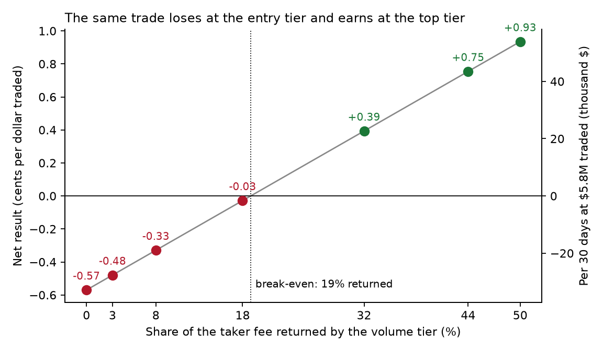

# polymarket-latency-arb

**Trade Polymarket's 5-minute BTC markets on the exchange price, before the Polymarket book has caught up.**

## The idea

Polymarket settles its BTC up/down markets on the Chainlink BTC/USD price. That price trails the exchanges: Chainlink lags Binance by about 1.5 s, and the Polymarket order book reprices only after the exchanges have moved.

We read the move at the source instead. Binance (hosted in AWS Tokyo) and Deribit feed one fused fair value, computed on a server in AWS London, the same region as Polymarket's matching engine. Polymarket approved our wallets for its co-location programme, which puts an order 15 ms from the engine. A small prediction model filters out the moves that will not carry through.

The trade itself is simple: buy the side of the latest 1 to 3 s exchange move in a small fixed clip and hold to resolution. Measured on the 5-minute markets, it earns **2.44 cents per dollar traded** before fees.

## What it earns after fees

Polymarket charges a taker `0.07 * p * (1 - p)` per share bought at price `p`, and returns a share `r` of that fee depending on the account's volume tier.

A dollar buys `1 / p` shares, so the fee per dollar traded is

```
f = 0.07 * p * (1 - p) / p = 0.07 * (1 - p)
```

With a gross edge of `g` per dollar, the net result per dollar is

```
net(r) = g - f * (1 - r)
```

At the typical price `p = 0.57` the fee is `f = 0.07 * 0.43 = 3.01` cents per dollar. That is more than the edge of `g = 2.44` cents, so the trade loses without a refund. It breaks even when `r = 1 - g / f = 1 - 2.44 / 3.01 = 19%`.



| Fee returned | Net per dollar traded | Per 30 days at $5.8M traded |
|---|---|---|
| 0% (new account) | -0.57 c | -$32,900 |
| 18% | -0.03 c | -$1,600 |
| 32% | +0.39 c | +$22,700 |
| 50% (top tier) | +0.93 c | +$53,900 |

The same trade, at the same speed, loses $32,900 a month on a new account and earns $53,900 at the top tier.

## The limitation

The tiers are 3, 8, 18, 32, 44 and 50% of the fee returned. The top tier needs **$10M of weighted volume per 30 days**, where each share counts as `(1 - p) * 2.3`. At `p = 0.57` that is about **$5.8M traded per month**, the volume used in the table.

That is volume, not capital. A 5-minute market pays out when it ends, so the same money is used again in the next one. There are `12 * 24 * 30 = 8,640` such markets in 30 days, which gives

```
5,760,000 / 8,640 = 667 dollars traded per market
```

About 55 clips of $12 in each market, reinvested 8,640 times. A working balance of a few thousand dollars covers it, with room for payouts that arrive a few minutes late.

The capital is small. The cost is the climb: a new account starts at 0% and has to trade its way up at a loss, about $32,900 for a month at full volume. Our own live result at that tier was about zero.

Two smaller obstacles remain: a 150 ms hold that Polymarket applies to taker orders, and a median of 4 rival bots chasing each move.

## Status

We have not found a way to reach that volume without losing money on the way up, so the gap stays locked for us. If you are rich, congratulations: this makes you richer.

Reproduce the figure and the table with `python figures/make.py`.

## What is in this repository

- `study/`: the analysis of the wallets that already run this trade, from public on-chain fills.
- `recorder/`: the live capture of the exchange feeds and the Polymarket book.
- `latency/`: lead-lag, co-location and network measurements.
- `bot/python/`, `bot/rust/`: the paper bot and the taker bot.
- `reports/`, `notes/`: the write-ups and the dated project log.

The code is a snapshot of an abandoned approach. Recorded data, model files and credentials are not included, so the bots do not run as shipped.

## License

polymarket-latency-arb is **source-available**, licensed under the [PolyForm Noncommercial License 1.0.0](./LICENSE), **not** an OSI open-source license.

- **You may** use, modify, fork, and share polymarket-latency-arb freely for any **noncommercial** purpose, as long as you keep the copyright and `Required Notice:` lines (see [`NOTICE`](./NOTICE)) and credit *"polymarket-latency-arb by Keygraph, Inc."*
- **You may not** sell it, bundle it into a paid product, or run it as a paid/hosted service **without a commercial license**.

Copyright (c) 2026 Keygraph, Inc. Commercial licensing enquiries: see [`NOTICE`](./NOTICE).
